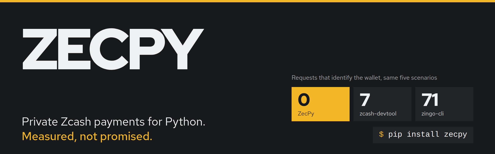

<p align="center">
  <a href="https://zecpy.pages.dev"></a>
</p>

<p align="center">
  <a href="https://pypi.org/project/zecpy/"></a>
  <a href="https://pypi.org/project/zecpy/"></a>
  <a href="docs/privacy-report.md"></a>
  <a href="docs/testnet-run.md"></a>
  <a href="#license"></a>
</p>

<p align="center">
  <a href="https://zecpy.pages.dev"><b>Website</b></a> ·
  <a href="https://zecpy.pages.dev/docs/">Docs</a> ·
  <a href="https://zecpy-live.pages.dev">Live demo</a> ·
  <a href="docs/privacy-report.md">Privacy report</a> ·
  <a href="docs/testnet-run.md">Testnet run</a> ·
  <a href="https://zecpy.pages.dev/llms.txt">llms.txt</a> ·
  <a href="CONTRIBUTING.md">Contributing</a>
</p>

---

**ZecPy lets any Python backend, bot or AI agent send and receive shielded Zcash in a few
lines of code.** It is private by default, and that is measured rather than claimed: across
creating a wallet, syncing, receiving, restarting and sending, the light server it talks to
receives **zero requests that identify the wallet**.

## The problem

Software has become the way the world pays. Subscriptions, APIs billed per call, marketplaces,
payroll, tipping bots, and now AI agents that buy data, compute and services on their own.
The demand for privacy in all of it is rising just as fast. A payment reveals who pays whom,
how much and how often: a company's suppliers, its payroll, a user's habits, an agent's
strategy. On most payment rails, all of that is visible to someone.

**Much of this infrastructure is written in Python.** It runs the backends of web services,
the data pipelines behind them, and most of the AI agent frameworks being built today. Yet a
Python developer who wants to accept or send **private** money has nowhere to start: no
shielded Zcash SDK exists for the language. The options are shelling out to a command-line
wallet, running a full wallet server beside the application, or giving up on privacy.

**And privacy on chain is not privacy end to end.** Shielded Zcash hides sender, receiver and
amount on the blockchain. But an application does not read the chain directly: it asks a
light server for blocks, and the questions themselves leak. Mainstream light wallets ask
about the user's transparent addresses, fetch the user's own transactions by id, and reveal
when the wallet was created and where its last sync stopped. The chain learns nothing; the
server learns who you are. We measured it: two established wallets sent their server **7**
and **71** requests that identify the wallet, over the same five everyday steps.

## The solution

**ZecPy brings shielded Zcash to Python, and closes the leak at the server.**

```python
from zecpy import Wallet

wallet, mnemonic = await Wallet.create("./shop", network="test",
                                       server="https://testnet.zec.rocks:443")
invoice = wallet.invoices.create(150_000, "order-77")     # its own shielded address
print(invoice.uri)                                         # zcash:...?amount=0.0015

async for event in wallet.invoices.watch(confirmations=3):
    if event.state == "confirmed" and event.invoice_settled:
        ship(event.invoice.reference)                      # exactly once, even after a restart
```

- **For Python developers:** one `pip install`, an async API built around what applications
  actually do (invoices, payouts, refunds, history), and integer zatoshis everywhere. No Rust
  toolchain, no node, no wallet server to run.
- **Private by default:** every network request was designed against what the light server
  can learn from it. ZecPy never queries transparent addresses, never looks up its own
  transactions by id, coarsens the wallet's birthday, saves the chain tip so the next sync
  cannot be linked to the last, and talks to the server over Tor on a fresh circuit for every
  sync and every send.
- **Built on Zcash's own code:** all keys, proofs, signatures and scanning come from
  [librustzcash](https://github.com/zcash/librustzcash), the library behind the official
  wallets, through a Rust extension. ZecPy reimplements no cryptography.

## Proof that nothing leaks

Privacy claims are easy to make. ZecPy ships the tool that checks them.

**1. A recording proxy between wallet and server.** [`tools/leak_audit`](tools/leak_audit)
sits between any light wallet and its server, forwards every byte unchanged, and labels
every request by what it reveals: public, coarse, broadcast, or identifying. Unknown requests
count as identifying, so the audit fails closed. Same five scenarios for each wallet, on a
local chain with real blocks and proofs:

| Scenario | ZecPy | zcash-devtool | zingo-cli |
|---|---:|---:|---:|
| Create a new wallet | **0** of 2 | 1 of 2 | 0 of 1 |
| First sync to the tip | **0** of 8 | 2 of 7 | 26 of 36 |
| Receive a payment, sync | **0** of 5 | 2 of 7 | 23 of 34 |
| Restart the process, sync | **0** of 5 | 2 of 7 | 22 of 32 |
| Send a payment | **0** of 1 | 0 of 1 | 0 of 1 |
| **Identifying requests** | **0** | **7** | **71** |

Raw logs and how to read them fairly: [docs/privacy-report.md](docs/privacy-report.md).

**2. The same audit on public testnet, over Tor.** A full merchant run against
`testnet.zec.rocks`: a watch-only shop paid from another wallet, the payment matched by
address alone, the memo read, a refund signed on an offline machine, and an AI agent that
refused a payment link over its budget and paid it within budget. **108 requests from the
shop; none identified it outside the opt-in memo fetch, which hid the real payment as the
6th of 8 among real third-party transactions.** Fourteen minutes, five transactions, every
txid listed: [docs/testnet-run.md](docs/testnet-run.md).

**3. 78 tests on a real chain.** The privacy guarantees are asserted by tests that run the
wallet through the audit proxy on a local regtest chain: no transparent queries, no lone
transaction lookups, decoys that never include a coinbase, a coarse birthday, nothing
linking one sync to the next. Reorgs are staged with `invalidateblock`. Each released wheel is also installed on its own platform in
CI and syncs a wallet over Tor on public testnet ([`tests/smoke.py`](tests/smoke.py)).

**4. Bugs found in Zcash's own code, and fixed upstream.** Measuring found problems in the
libraries every Zcash wallet builds on. Each is filed with a tested fix:

| Where | Finding | Filed |
|---|---|---|
| librustzcash sync | Every incremental sync tells the server where the last one stopped, linking sessions | [#3197](https://github.com/zcash/librustzcash/issues/3197), fix [PR #3198](https://github.com/zcash/librustzcash/pull/3198) |
| librustzcash sync | A reorg onto a branch that is not yet longer goes unnoticed; the wallet reported 4 confirmations when the truth was 1 | fix [PR #3199](https://github.com/zcash/librustzcash/pull/3199) |
| zcash-devtool | `pczt sign` leaves Ironwood spends unsigned, exits successfully, and the send fails | [#266](https://github.com/zcash/zcash-devtool/issues/266), fix [PR #267](https://github.com/zcash/zcash-devtool/pull/267) |

ZecPy carries its own sync loop until upstream adopts these; the goal is to delete it.

## Quick start

```bash
pip install zecpy
```

Prebuilt wheels for **Linux x86_64** and **macOS on Apple silicon**, Python 3.10 or newer.
Nothing compiles on your machine: the wheel carries librustzcash, a Tor client, SQLite and
the Sapling proving parameters. Other platforms [build from source](#build-from-source).

A complete program: create a testnet wallet, issue an invoice, wait for it to be paid.

```python
import asyncio
from zecpy import Wallet

async def main():
    wallet, mnemonic = await Wallet.create(
        "./shop", network="test", server="https://testnet.zec.rocks:443")
    # Store mnemonic.reveal() offline: it is returned once and never written to disk.

    invoice = wallet.invoices.create(150_000, "order-77")   # 0.0015 TAZ
    print("Pay this:", invoice.uri)

    async for event in wallet.invoices.watch(confirmations=3):
        print(event.state, event.value_zat, event.invoice.reference)
        if event.state == "confirmed" and event.invoice_settled:
            break

asyncio.run(main())
```

Testnet coins (TAZ) are free from the [testnet faucet](https://faucet.testnet.valargroup.dev).

<details>
<summary><b>Pay many people in one transaction</b></summary>

```python
from zecpy import Payout

txid = await wallet.send_many([
    Payout("u1...ada", 125_000_000, "October salary"),
    Payout("u1...lin",  80_000_000),
])
```

Up to 50 recipients, one shielded transaction: cheaper than separate sends, and no burst of
payments whose timing links them. [`examples/payroll.py`](examples/payroll.py) pays a CSV.
</details>

<details>
<summary><b>Let an AI agent pay, within a budget it cannot be talked out of</b></summary>

```python
request = wallet.parse_request(uri)            # local: show it, never act on its text
txid = await wallet.pay(uri, max_zat=200_000)  # refused whole if it asks for more
```

A payment link that asks for more than `max_zat`, or names no amount, raises `PrivacyError`
before anything is built. The [agent guide](https://zecpy.pages.dev/docs/agents) shows how to
expose this to an agent framework.
</details>

<details>
<summary><b>Keep the spending key on an offline machine</b></summary>

```bash
zecpy-cold --network test new > bundle.json          # offline: seed + watch bundle
```

```python
wallet = await Wallet.watch("./hot", open("bundle.json").read(),
                            server="https://testnet.zec.rocks:443")
pczt = wallet.propose_cold("u1...", 50_000)          # built and proved on the server
open("refund.pczt", "wb").write(pczt)
# offline: zecpy-cold --network test sign refund.pczt refund.signed.pczt
txid = await wallet.broadcast_signed(open("refund.signed.pczt", "rb").read())
```

The server holds a viewing key only, so it can be fully compromised without losing funds.
The offline signer finds change with its own key, so the server cannot disguise a payment
to itself as change.
</details>

<details>
<summary><b>See the fee before paying it</b></summary>

```python
plan = wallet.propose("u1...", 50_000)
print(plan.fee, plan.change, plan.crossing_value)
txid = await wallet.send_proposal(plan)              # exactly that transaction
```
</details>

## Features

| | What it does | Privacy property |
|---|---|---|
| **Invoices** | `invoices.create`, `watch`, `poll`, `status` | Each invoice has its own diversified address; payments are matched during local trial decryption, with no memo and no request |
| **Payment events** | `detected`, `confirmed`, `reverted` | Delivered once per state, persisted across restarts; reorgs are detected, not ignored |
| **Sending** | `send`, `send_many` (up to 50) | Proved and signed locally; transparent recipients refused unless allowed |
| **Fee preview** | `propose`, `send_proposal`, `propose_sweep` | Shows any amount a pool crossing would make public, and refuses it unless allowed |
| **Agent payments** | `parse_request`, `pay(uri, max_zat=...)` | A hard budget the payment link cannot raise |
| **Cold signing** | `Wallet.watch`, `propose_cold`, `zecpy-cold` | The online server never holds a spending key |
| **History** | `transactions`, `transaction`, `balance` | Read from the local database: listing history sends nothing |
| **Memos** | `fetch_memos` (opt-in) | Each real transaction fetched among 7 decoys, rank-uniform, on its own Tor circuit |
| **Network** | Tor by default (arti) | A fresh isolated circuit per sync and per send; never a silent direct fallback |
| **Broadcast timing** | `max_broadcast_delay` | Publishes after a random delay, so a payment does not appear at the moment of the checkout that caused it |

Full reference: [zecpy.pages.dev/docs/api](https://zecpy.pages.dev/docs/api).

## What ZecPy refuses to do

Each of these is a request a light server could use to identify the wallet, or a cost to
privacy that ZecPy will not hide behind a default.

| Refused | Why | If you need it |
|---|---|---|
| Paying transparent addresses | Amount and recipient would be public | `allow_transparent=True` |
| Pool crossings that publish an amount | The value appears in the bundles' balances | `allow_pool_crossing=True` |
| Transparent receiving and shielding | Needs queries that name the wallet's addresses | zcash-devtool `wallet shield` |
| Memo fetching by default | Every fetch names a transaction | Opt in with `fetch_memos()` |
| Mempool watching | `GetMempoolTx` would reveal the transactions the wallet knows | Detection at the next block |
| A direct connection when Tor fails | It would reveal the user's IP address | `tor=False`, explicitly |

Refusals raise `PrivacyError` with the reason and the flag that overrides it.

## How it works

```text
your application
      │  async Python API: Wallet, invoices, cold signer              python/zecpy/
      ▼
ZecPy native core (Rust, PyO3)                                         src/
      │  its own sync loop: saved tip state, aligned batches, reorg checks
      │  send, PCZT build and sign, pool-crossing checks
      │  Tor client (arti): an isolated circuit per sync and per send
      ▼
librustzcash: zcash_client_backend 0.25, zcash_client_sqlite 0.23, orchard 0.16, pczt 0.10
      │  keys, trial decryption, Halo 2 and Groth16 proving, signing
      ▼
light server (lightwalletd or Zaino) over Tor  ◄──  tools/leak_audit records every request
```

Python owns the developer-facing API and the invoice book. Rust owns everything
cryptographic and everything that talks to the chain. The wallet is a directory: the
librustzcash SQLite database, the invoice book, the saved chain state and the Tor state. The
seed is never written to disk, and seeds, keys and memos are kept out of logs, reprs and
error messages. Details: [docs/architecture.md](docs/architecture.md) and the
[privacy model](docs/privacy-model.md).

## Status

ZecPy is **alpha**: built for [ZECATHON](https://thezecathon.com) (Core & Tooling), tested
hard, not yet audited. Use testnet, or mainnet amounts you can afford to lose.

- **Real and tested:** everything above, on a local regtest chain with real blocks, proofs
  and reorgs (78 tests), and on public testnet over Tor ([record](docs/testnet-run.md)). A
  send takes about 11 seconds on a 4-core machine; the fee is 10,000 zatoshis.
- **Unit-tested only:** the pool-crossing refusal. Funds arrive in Ironwood on current
  chains, so no real Orchard to Ironwood crossing could be built; the check itself is
  librustzcash's `Step::is_canonical_crossing`.
- **Known limitations:** one account per wallet; no Windows wheel yet; a reorg costs one
  identifying tree-state request; a payment orphaned by a reorg stays pending until it is
  mined again ([details](docs/privacy-model.md#known-limitations)).
- **No mainnet funds were moved** during development.

## The ZecPy ecosystem

| Project | What it is |
|---|---|
| [**zecpy.pages.dev**](https://zecpy.pages.dev) | Website and documentation: quick start, guides, API reference, privacy model |
| [**ZecPy Live**](https://zecpy-live.pages.dev) ([source](https://github.com/xerodahdev/zecpy-demo)) | Press Run and watch every request the light server receives, as it arrives |
| [**llms.txt**](https://zecpy.pages.dev/llms.txt) · [**AGENTS.md**](https://zecpy.pages.dev/AGENTS.md) | The docs as plain text for language models, and rules for coding agents |
| [**Checkout API**](examples/checkout) | A FastAPI shop backend with signed webhooks and no spending key on the server |
| [**Payroll**](examples/payroll.py) | Pay a CSV in one shielded transaction, optionally through the cold signer |

## Build from source

Needs a Rust toolchain (tested with 1.99). The first build compiles librustzcash, which takes
11 to 19 minutes on a 4-core machine.

```bash
git clone https://github.com/xerodahdev/zecpy && cd zecpy
uv venv .venv && . .venv/bin/activate          # or: python -m venv .venv
uv pip install -e '.[dev,examples]'
```

Run the tests against a local chain ([devnet/README.md](devnet/README.md) lists the
binaries): `devnet/up.sh <shielded address>`, then `pytest`. Tor tests against public
testnet: `pytest -m network`.

## Contributing

ZecPy has one rule that outranks the rest: **the leak budget is zero.** A change that makes
the light server learn something new about the wallet is a bug, however useful the feature.
[CONTRIBUTING.md](CONTRIBUTING.md) explains how to set up the local chain, how to prove a
change leaks nothing with the audit proxy, and where help is most wanted: a Windows wheel,
more wallets in the privacy report, and an MCP server for agents.

Found a leak or a vulnerability? Please report it privately: [SECURITY.md](SECURITY.md).

## Acknowledgements and prior art

- [librustzcash](https://github.com/zcash/librustzcash) does all of the cryptography and the
  wallet logic underneath ZecPy.
- [zcash-devtool](https://github.com/zcash/zcash-devtool), the official CLI on the same
  crates, was the reference for how they fit together, and is the control wallet in the
  privacy report. [zingo-cli](https://github.com/zingolabs/zingolib) is the second.
- [arti](https://gitlab.torproject.org/tpo/core/arti) provides the Tor client.
- [pyzcash](https://github.com/davisonio/pyzcash) offers Python bindings for addresses,
  ZIP-321 and seed derivation, without sync or send.
  [zeccheckout](https://github.com/samizdatproject/zeccheckout) is a Rust checkout service
  using the same viewing-key invoice idea, as a service rather than a library.

## License

Licensed under either of [Apache License 2.0](LICENSE-APACHE) or [MIT](LICENSE-MIT), at your
option.
