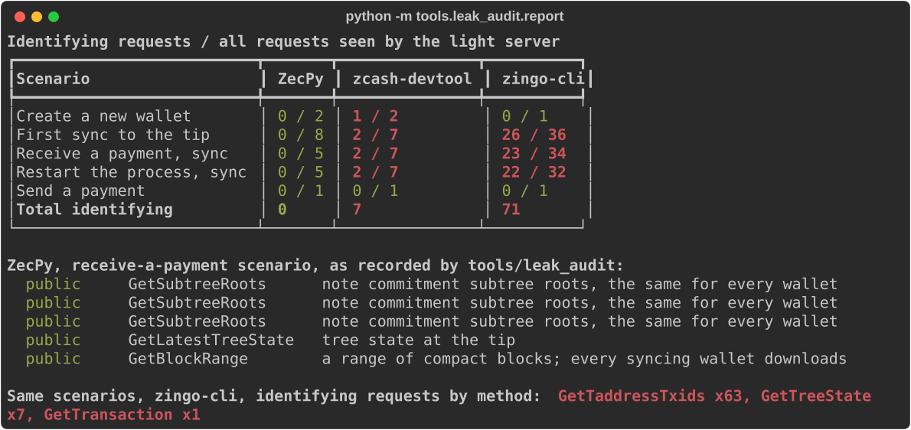

# ZecPy

**Shielded Zcash for Python backends, with privacy you can measure: across create, sync, receive, restart and send, ZecPy sends its light server zero identifying requests. Two reference wallets send 7 and 71.**

[Privacy report](docs/privacy-report.md) · [Testnet run](docs/testnet-run.md) · [Bugs found upstream](docs/upstream/README.md) · [Checkout API example](examples/checkout/README.md) · [Privacy model](docs/privacy-model.md)



Built for ZECATHON (Core & Tooling) on librustzcash, Orchard and Ironwood, with Tor via arti.

## The problem

A Python developer who wants to accept ZEC today shells out to a CLI or runs a full wallet
server, and the light wallet code they would build on asks its server questions that give
the user away: which transparent addresses are theirs, which transactions are theirs, where
their last sync stopped. "Shielded" on chain, identifiable at the server.

## What ZecPy does

```python
wallet, mnemonic = await Wallet.create("./shop", network="test", server="https://testnet.zec.rocks:443")
invoice = wallet.invoices.create(150_000, "order-77")   # its own shielded address + ZIP-321 URI
async for event in wallet.invoices.watch(confirmations=3):
    if event.state == "confirmed" and event.invoice_settled:
        ship(event.invoice.reference)                    # exactly once, even across restarts
```

- **Invoices** with a fresh diversified address each: payments match during local trial
  decryption, with no memo and no request to the server. Events are `detected`, `confirmed`
  and `reverted` (a reorg removed the block), persisted so a restart never re-delivers.
- **Sending**: `send` and `send_many` (up to 50 recipients, one transaction), proved and
  signed locally. Transparent recipients raise `PrivacyError` unless explicitly allowed.
- **Cold signing**: the server imports a viewing key only (`Wallet.watch`), builds and
  proves a PCZT; the offline `zecpy-cold` signer shows what will leave the wallet and signs.
- **Tor by default**: every sync session and every broadcast on its own isolated circuit,
  retried on fresh circuits, never falling back to a direct connection.
- **Fee preview**: `propose` shows the fee, the notes spent, the change and any value that
  would become public by crossing pools; `send_proposal` sends exactly that transaction.
  A crossing that publishes its amount raises `PrivacyError` unless allowed.
- **Payment links for agents**: `pay(uri, max_zat=...)` pays a ZIP-321 request, refused
  whole if it asks for more than the budget or names no amount.
- **History and memos**: `transactions()` reads the local database only. Received memos are
  opt-in (`fetch_memos`), since compact blocks do not carry them: each real fetch goes out
  over Tor shuffled among 7 decoy transactions from nearby blocks.
- **Sweep**: `propose_sweep` empties a wallet, fee included, with nothing left behind.

## How it works

```text
python/zecpy/     Wallet, invoices, cold signer, async API            (Python)
src/              PyO3 core: sync loop, send, PCZT, Tor connections    (Rust)
                  └─ librustzcash: zcash_client_backend 0.25, zcash_client_sqlite 0.23,
                     orchard 0.16, pczt 0.10, zcash_proofs (bundled Sapling params)
tools/leak_audit/ gRPC proxy that decodes and classifies every request a wallet makes
devnet/           local regtest chain: zebrad 7.0.0 + lightwalletd 0.6.0, Ironwood active
```

No cryptography is reimplemented. Details: [docs/architecture.md](docs/architecture.md).

## Technical highlights

- **A leak in librustzcash's own sync, found by measuring.** `sync::run` asks for the tree
  state where the previous sync stopped, linking sessions. ZecPy's sync loop
  ([src/sync.rs](src/sync.rs)) takes the tip's state from `GetLatestTreeState`, saves it, and
  splits batches only at absolute multiples of 1,000.
- **A reorg bug it also shares:** a reorg onto a branch that is not yet longer went unnoticed.
  ZecPy compares block hashes at the tip. Both fixes are prepared as a tested librustzcash
  patch, plus a reproduced zcash-devtool bug (its `pczt sign` skips Ironwood spends).
- **A signer that does not trust the server.** `zecpy-cold` identifies change outputs with
  its own viewing key, so a compromised server cannot disguise a payment to itself as
  change ([src/cold.rs](src/cold.rs)).

## Quick start

Needs Linux, Python 3.10+ and a Rust toolchain (tested with 1.99). Tested from a fresh
clone with uv; the build took 11 minutes on a 4-core VPS,
plus the time to download the crates.

```bash
git clone https://github.com/xerodahdev/zecpy && cd zecpy
uv venv .venv && . .venv/bin/activate        # or python -m venv (Debian/Ubuntu: apt install python3-venv)
uv pip install -e '.[dev,examples]'
python -c "import zecpy; print(zecpy.__all__)"
```

Run the tests against a local chain ([devnet/README.md](devnet/README.md) lists the
binaries): `devnet/up.sh <shielded address>`, then `pytest`. Tor tests against public
testnet: `pytest -m network`.

## What is real, what is not

- **Real, tested:** everything above, on a local regtest chain with real blocks, proofs and
  reorgs (`invalidateblock`): 78 tests. A send takes about 11 s on a 4-core VPS; the fee is
  10,000 zatoshis.
- **Real, public network:** a full merchant run on testnet against `testnet.zec.rocks`
  ([record](docs/testnet-run.md)). A watch-only shop was paid by zcash-devtool, matched the
  payment by address, read the memo among 7 real third-party decoys, and refunded through
  the offline signer. An agent wallet refused a payment link over budget, then paid it
  within budget over ZecPy's own Tor. Fourteen minutes, five transactions, all txids
  listed. The shop's 108 requests were audited on their way to the server over Tor: none
  identified it outside the opt-in memo fetch. No mainnet funds were moved.
- **Unit-tested only:** the pool-crossing refusal. The regtest chain activates Ironwood at
  height 1, so it never holds Orchard notes and no real crossing can be built there; the
  per-pool calculation is tested on constructed inputs, and the ZIP 318 canonical check is
  librustzcash's own `Step::is_canonical_crossing`.
- **By design, not built:** transparent receiving (it needs requests that identify the
  wallet; see the table below). The `pczt` dependency compiles librustzcash's
  transparent code in; ZecPy never calls it, and the leak audit checks that on every run.

## What ZecPy deliberately does not do

Each of these is a request a light server could use to identify the wallet, or a feature
whose privacy cost ZecPy will not hide behind a default.

| Not done | Why | Where it lives instead |
|---|---|---|
| Transparent receiving and shielding | Needs `GetAddressUtxos`/`GetTaddressTxids` queries that name the wallet's addresses | zcash-devtool `wallet shield` |
| Memo fetching by default | Every fetch names a txid; ZecPy makes it opt-in and hides it among decoys | `fetch_memos()` |
| Mempool watching | Detection waits for the block; `GetMempoolTx` would send the txids the wallet knows | Compact blocks at the next block |
| Status lookups for orphaned payments | `GetTransaction` by txid; an orphaned payment stays pending until re-mined | See the privacy model |
| More than one account, multisig, hardware wallets | Out of scope for a backend SDK | zcash-devtool `zip48`, `pczt` |

## Limitations and next

Linux only, built from source; no prebuilt wheels yet. A reorg costs one identifying
tree-state request, and an orphaned incoming payment stays pending until it is re-mined
([details](docs/privacy-model.md#known-limitations)). Next: wheels for macOS and Windows,
and the upstream fixes through review.
